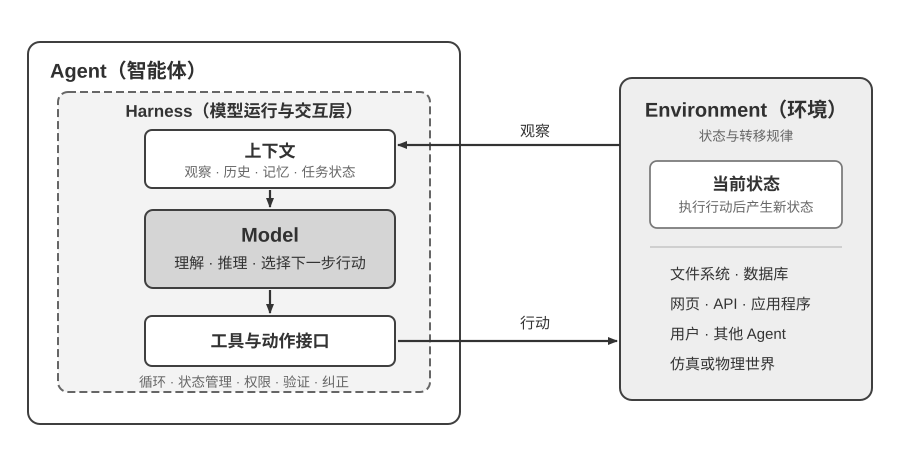
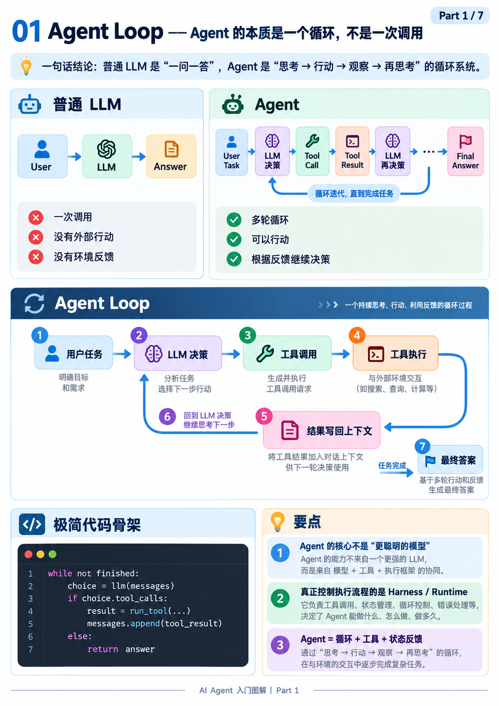
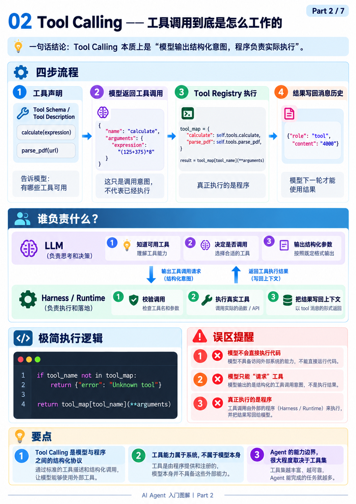
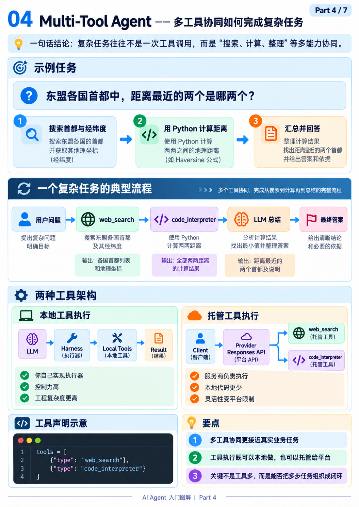
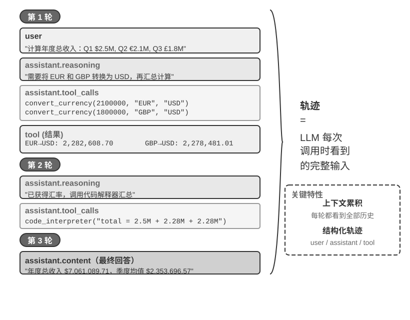
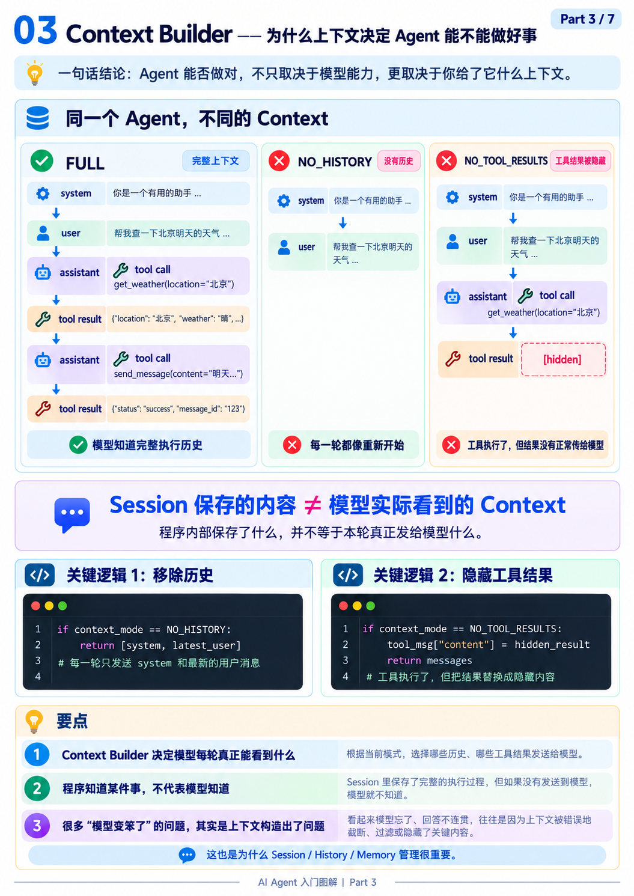
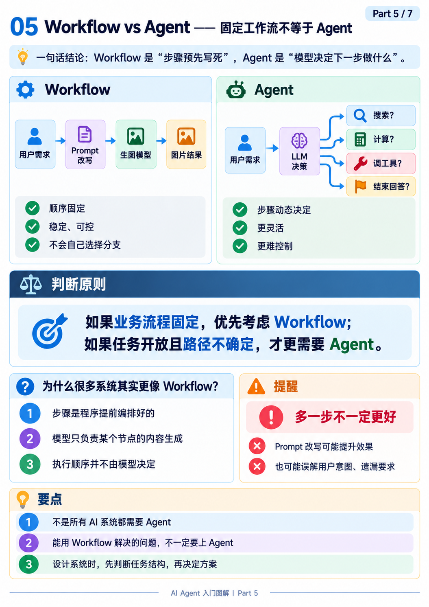
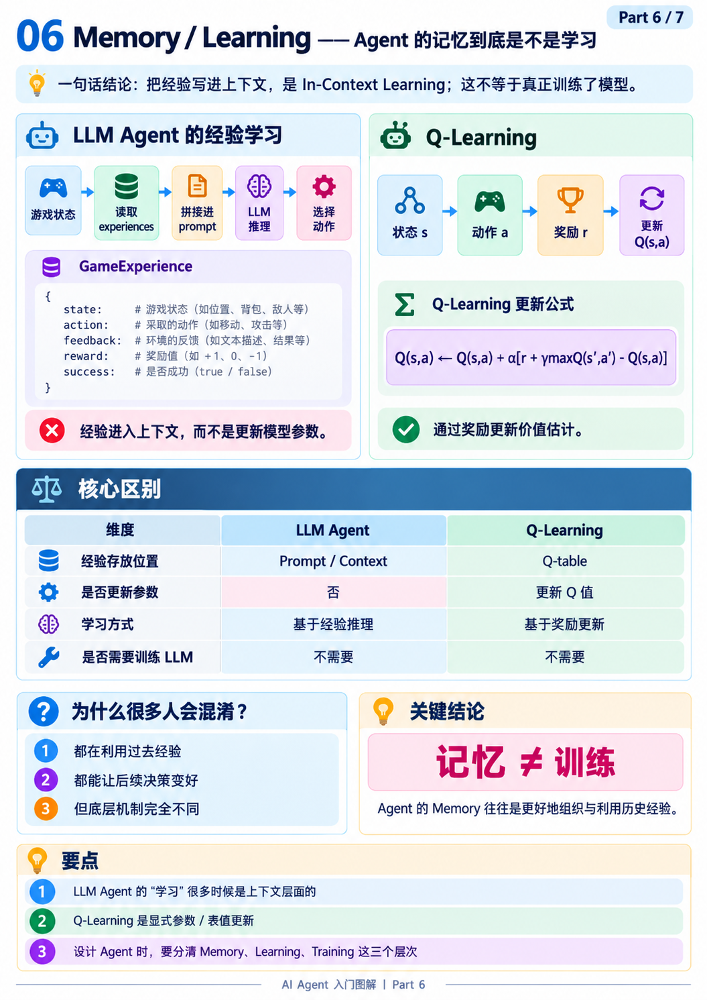
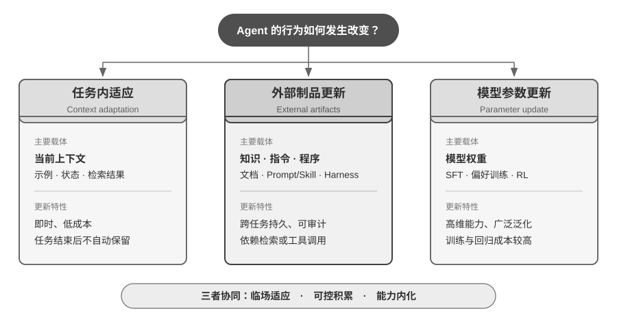
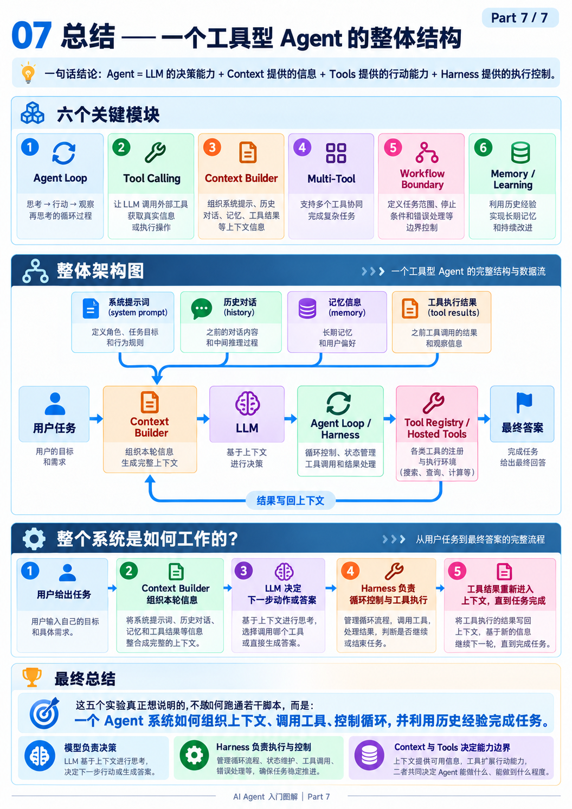

# 第一章：AI Agent 入门

> 教材：[《深入理解 AI Agent》第一章](https://github.com/bojieli/ai-agent-book/blob/main/book/chapter1.md)  
> 学习内容：第一章理论 + 五组配套实验

## 1. Agent 的基本架构

最基本的公式是 **Agent = LLM + Context + Tools**，可以理解为大脑、眼睛和手脚：LLM 负责决策，Context 提供决策需要的信息，Tools 负责与外部世界交互。

从工程角度，还需要区分 **Model、Harness 和 Environment**。Model 是决策核心；Harness 是模型外部的运行框架，管理上下文、工具调用和执行流程；Environment 则是文件、网页、数据库等被 Agent 操作的外部环境。

**Agent = Model + Harness，Agent 与 Environment 形成交互闭环。**

这两个公式不是互相替代：前者从功能组件理解 Agent，后者强调 Model 与 Harness 的分工。

一个容易忽略的认识：模型不变，扩大它的观察范围和可执行操作，也能显著增强 Agent 的能力。但工具越多不一定越好，能力边界也意味着权限与风险边界。



## 2. ReAct 与 Tool Calling

Agent 与普通 LLM 最大的区别，是可以通过 **ReAct（Reasoning + Acting）** 持续推进任务：

**思考 → 行动 → 观察 → 再思考，直到任务完成。**



Tool Calling 也没有想象中复杂。开发者先把工具的名称、功能和参数格式告诉模型，模型生成工具调用请求，Harness 执行后再把结果作为 `tool` 消息放回上下文。



教材中的 Agent Loop，去掉日志和异常处理后，大致就是：

```python
trajectory = [user_request]

while True:
    decision = llm(build_context(trajectory))
    trajectory.append(decision)

    if not decision.tool_calls:
        return decision.answer

    for call in decision.tool_calls:
        result = execute_tool(call)
        trajectory.append(result)
```

这里最值得记住的是：**LLM 决定做什么，Harness 负责怎么执行。** 模型返回的 Tool Call 只是调用意图，不代表工具已经执行。

**实验 1-2（Web Search）** 展示了模型如何自主搜索、阅读结果并决定是否继续搜索；**实验 1-3（Search + CodeGen）** 则进一步说明，一个复杂任务可能需要搜索、代码计算和总结等多种工具配合。工具既可以由本地 Harness 执行，也可以由模型服务商托管。



Agent 每一轮的决策、调用和结果会形成 **Trajectory（执行轨迹）**。它既是下一轮推理的历史依据，也是之后调试、评估和改进 Agent 的重要证据。



## 3. Context：模型真正看到了什么？

Context 不只是聊天记录，主要包括系统提示词、工具定义、用户消息、模型回复和工具结果。可以概括为：

**Context = Static Prefix（静态前缀）+ Trajectory（动态轨迹）**

Session 保存了多少信息，与每轮实际送给模型多少信息，是两回事。Context Builder 的工作就是决定模型当前应该看到哪些内容。



**实验 1-1（Context Ablation）** 通过依次移除部分上下文来观察 Agent 行为：

| 消融内容 | 主要影响 |
|---|---|
| History | 丢失进度，容易重复操作 |
| Tool Definitions | 失去对应的工具调用能力 |
| Tool Results | 无法根据执行结果继续决策 |
| Reasoning | 影响不一定明显，部分信息可从其他历史重建 |

这个实验最有价值的结论并不是“上下文越多越好”，而是**关键的信息不能丢，冗余的信息没必要全部保留**。

尤其要警惕：Agent 即使缺乏必要的工具和真实观察，也可能生成看起来正确的答案。因此，给出了答案不等于完成了任务。


## 4. Workflow 还是 Autonomous Agent？

两者的区别在于**执行路径由谁决定**。

Workflow 的流程由程序预先编排，例如“用户需求 → Prompt 改写 → 生图”。模型只负责某个节点的处理，流程稳定、可控。

Autonomous Agent 则根据任务和环境反馈动态决定下一步，更灵活，但成本和出错风险也更高。



**实验 1-4（Image Gen Workflow）** 比较了“先改写提示词再生图”和“原生模型直接生图”。它想说明的是：随着模型能力增强，原本用来弥补模型短板的额外步骤，可能逐渐失去必要性。

因此选型应该遵循：

**单次 LLM 调用 → Workflow → Autonomous Agent**

能简单解决就不要复杂化。固定的业务约束交给程序，需要灵活判断的部分才交给模型，两种模式也完全可以混合。

## 5. Memory 与 Learning

**实验 8-1 / 8-2（Learning from Experience）** 用寻宝游戏比较传统 Q-Learning 和 LLM 利用历史经验决策的方式。

Q-Learning 通过奖励不断更新 Q 表，逐渐形成策略。LLM Agent 则保存过去的状态、动作、反馈与奖励，在下一次决策时将相关经验放进 Prompt。后者并没有因为保存经验就更新模型权重。



教材进一步把 Agent 的能力更新分成三个层次：

| 层次 | 更新什么 | 作用 |
|---|---|---|
| Context Adaptation | 当前上下文 | 任务内临时适应 |
| Artifact Update | Memory、Skill、Prompt、程序 | 跨任务保留经验和规则 |
| Parameter Update | 模型参数 | 通过训练内化能力 |



这里要记住：**Memory 不等于 Training。** 很多所谓 Agent 的“学习”，其实只是把历史经验组织得更好，让模型在后续任务中使用。

## 6. Harness：真正的工程重点

前面讨论的 Context 和 Tools 解决了 Agent **能不能做事**的问题，而生产级 Harness 更关心它**能否可靠、安全地做事**。

教材将 Harness 归纳为五个要素：

| 要素 | 职责 |
|---|---|
| Context | 给模型正确的信息 |
| Tools | 提供观察与行动接口 |
| Constrain | 限制不允许的操作 |
| Verify | 检查是否真的做对 |
| Correct | 失败后修复、重试或回滚 |

例如 Coding Agent 修改代码后，不能只因为模型说“修复完成”就结束，而是需要运行测试、检查结果，失败后再尝试修复。

安全护栏也分为三个层次：**上下文层**防范恶意输入和提示注入，**执行层**限制工具权限和高风险动作，**数据层**通过数据库权限等底层机制确保越权操作不能真正生效。重要操作不能只依赖 Prompt 中的安全要求。

教材最后提出的五条设计模式也值得留下：

- **Proposer–Reviewer**：生成与审核分离，尽量用独立证据验证结果。
- **Progressive Disclosure**：先给概要，再按需加载详细信息。
- **Append-only**：保留可追溯的历史，便于审计和回放。
- **Boundary Set + Retention Set**：既检查问题是否修复，也检查原有正确行为是否受影响。
- **Minimal Diff + Rollback**：尽量小范围修改，并保证可以回滚。

对初学者而言，不需要一次实现全部机制。先让 Agent Loop 跑通，再围绕真实失败逐步增加约束、验证和纠正即可。

## 7. 总结



这一章最终建立了三个层次的认识：

**① Agent 的能力从哪里来？**  
来自 Model 的决策能力，以及 Context 和 Tools 提供的观察、行动能力。

**② Agent 是怎么工作的？**  
通过 ReAct 循环，把模型决策、工具执行和环境反馈连接起来。

**③ 为什么有的 Agent 只是 Demo，有的能成为产品？**  
区别往往在 Harness：是否有合理的状态管理、权限约束、结果验证和错误恢复。

五组实验分别从 Context、ReAct、Multi-Tool、Workflow 和 Learning 的角度展示了这些机制。

**最终理解：模型决定下一步做什么，Harness 负责让这个决定真正、可靠地执行。**

---

### 附：实验源码索引

| 实验 | 值得看的函数 |
|---|---|
| 1-1 Context | `agent.py` → `_prepare_messages_for_api()` |
| 1-2 Web Search | `agent.py` → `search_and_answer()` |
| 1-3 Search + CodeGen | `agent.py` → `_tools()`、`process_request()` |
| 1-4 Image Workflow | `pipeline.py` → `run_workflow_route()` |
| 8-1 / 8-2 Learning | `llm_agent.py` → `_build_context()`、`update_experience()` |
